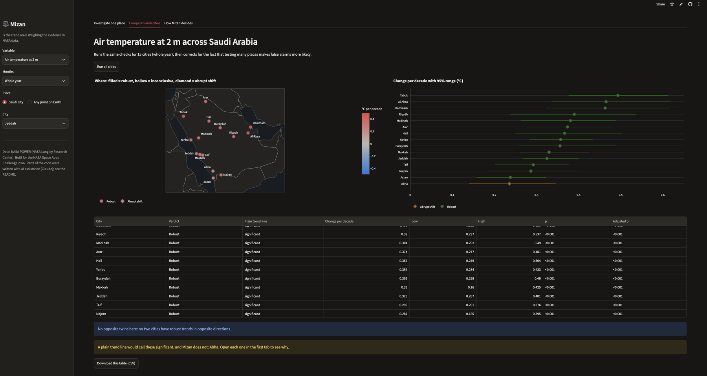

# Mizan: is the trend real?

**NASA Space Apps Challenge 2026** · Challenge: *Be An Earth System Trend Detective!* · Universal Event

**Live app:** https://mizan-trends.streamlit.app

Mizan weighs the evidence before calling a change in NASA data a trend.
Pick a place and a variable. Mizan shows how it has changed since 1981, how fast it is changing
per decade, and a verdict with its reasons: **Robust**, **Inconclusive** or **Abrupt shift**.



## Why

A rising line is easy to draw and easy to misread. A spreadsheet trend line assumes every year is
independent and accepts whatever start year you give it. Mizan is for people who have to judge a
claim about a changing climate without a statistics degree: journalists, teachers, students and planners.

## How it answers the challenge

| The challenge asks | Mizan's answer |
|---|---|
| What is changing? | Seven NASA POWER variables, by season |
| Where? | Any point on Earth, with 15 areas of Saudi Arabia built in and mapped |
| How much? | Theil-Sen slope per decade with a 95% range |
| Is it statistically significant? | Four checks, listed below, plus false-discovery control across places |
| The same variable moving in opposite directions | An "opposite twins" search across places |

## The decision rule

The same four checks, in the same order and with the same thresholds, for every place, variable and season.

| Check | Question | Passes when |
|---|---|---|
| Record length | Is there enough data? | At least 20 complete years |
| Noise test | Could random variation explain it? | Mann-Kendall p below 0.05 after an autocorrelation correction, and the 95% range of the slope excludes zero |
| Shift check | Is it gradual? | A single step does not fit clearly better than a line (BIC difference of 6 or less), or a significant same-direction trend exists on one side of the step |
| Stress test | Does it survive other start and end years? | At least 90% of all periods of 20+ years have the same direction as the full record (records under 30 years, possible only for a custom point: periods of at least 60% of the record) |

- **Robust:** passes all four.
- **Inconclusive:** fails the noise test or the stress test. This does not mean nothing is changing. It means this record cannot show it.
- **Abrupt shift:** significant, but concentrated in one step. It may be a real shift or a change in what the model was fed.

## What we found

We ran Mizan on 15 areas × 7 variables × 5 seasons = 525 tests (`scan.py`, results in `results/all_results.csv`).

| Finding | Detail |
|---|---|
| A plain trend line over-claims | An ordinary straight-line fit calls 319 of the 525 tests significant. Mizan accepts 189 of them and rejects 130. |
| Clearest example | Sunlight in the Tabuk area, whole year. A plain line reports p < 0.001. Mizan: inconclusive, p = 0.16, range −0.11 to +0.89 MJ/m²/day per decade. |
| Warming is everywhere | Yearly air temperature rises in all 15 areas, by 0.24 to 0.49 °C per decade. Fourteen are Robust and one (Abha) is an Abrupt shift. |
| Shifts cluster in time | Of 22 abrupt shifts, 10 fall in 1998-1999 (temperature and humidity) and 6 in 1994-1995 (sunlight): 16 shifts across 12 place-variable pairs in 7 areas. |
| Rainfall and humidity | No robust trend in any area or season (0 of 150 tests). |
| No opposite twins | No variable and season has two Saudi areas with robust trends in opposite directions. |

The clustering of shift years is an open question. Some of the places are neighbours (Dammam and Al-Ahsa),
others are more than 1,200 km apart (Tabuk and Abha). A year shared by different places points either to a
real regional shift or to a change in the record behind the data. We have not established which.
Candidates we would test: recovery from the 1991 Mount Pinatubo eruption for the 1994-1995 sunlight shifts,
and the 1997-1998 El Niño for the 1998-1999 shifts. The sunlight record's change of source (see NASA data
below) happens in 2001, and none of the 22 shifts falls in 2001, so it does not explain these clusters.

## How well calibrated is Mizan?

`calibration.py` runs Mizan, and an ordinary straight-line fit, on simulated 45-year records where the truth
is known (300 records per case). Trends have year-to-year autocorrelation 0.3; steps happen in 2001.

| Simulated truth | Plain line significant | Mizan: Robust | Mizan: Abrupt shift |
|---|---|---|---|
| Pure noise, independent years | 4% | 3% | 0% |
| Pure noise, autocorrelation 0.3 | 16% | 6% | 0.3% |
| Pure noise, autocorrelation 0.5 | 27% | 6% | 0.7% |
| Weak trend (0.3 sd per decade) | 66% | 24% | 4% |
| Moderate trend (0.6 sd per decade) | 99% | 73% | 9% |
| Clear trend (1.0 sd per decade) | 100% | 93% | 6% |
| Small single step (1 sd) | 76% | 50% | 5% |
| Large single step (2 sd) | 100% | 39% | 59% |

On noise where neighbouring years resemble each other, as they do in climate data, a plain line raises a false
alarm up to 27% of the time; Mizan stays near 6%. The cost: Mizan misses most weak trends, and it cannot always
tell a step from a gradual change (it calls a small step Robust half the time).

## Limits

- Each value is one NASA POWER grid cell, roughly 50 km wide. "Jeddah" means the Jeddah area. Near a coast the cell mixes land and sea, and it cannot see a city's own heat island.
- Rainfall verdicts in deserts are unreliable: mostly zeros, rare storms, and weak model rainfall.
- Records start in 1981 (1984 for sunlight).
- The sunlight record joins two products: GEWEX SRB up to 2000 and CERES from 2001. NASA advises against
  using it to assess climate trends across a change of source, so sunlight verdicts for whole records deserve caution.
- A robust trend says that something changed, not why.
- The "Any point on Earth" option needs a live connection to NASA POWER. The 15 built-in areas use saved copies in `data/`.

## Run it

```
pip install -r requirements.txt
streamlit run app.py
```

| Command | What it does |
|---|---|
| `python -m pytest` | Runs the automated checks |
| `python scan.py` | Re-runs all 525 tests from the saved data |
| `python calibration.py` | Re-runs the calibration simulation and prints the table above (about 5 minutes; add `--csv` to save `results/calibration.csv`) |
| `python prefetch.py` | Downloads the built-in areas from NASA POWER into `data/` |

## Files

- `app.py` the web app (Streamlit + Plotly)
- `stats.py` the trend tests and the verdict logic
- `power.py` downloads and prepares NASA POWER data
- `scan.py`, `calibration.py`, `prefetch.py` the scripts in the table above
- `data/` saved NASA POWER records for the built-in areas, each with its request URL and access date
- `results/all_results.csv` every verdict from the scan
- `results/calibration.csv` the calibration table above
- `tests/` automated checks

## NASA data

**NASA POWER** (Prediction Of Worldwide Energy Resources), NASA Langley Research Center, monthly API:
https://power.larc.nasa.gov/ . Meteorological values come from NASA's MERRA-2 model. Sunlight
(`ALLSKY_SFC_SW_DWN`) comes from NASA GEWEX SRB Release 4.0-IP (1984-2000), then CERES SYN1deg
(2001 onwards), as listed in POWER's data sources:
https://power.larc.nasa.gov/docs/methodology/data/sources_fluxes/ .
Accessed 14 November 2026. Parameters: `T2M`, `T2M_MAX`, `T2M_MIN`, `PRECTOTCORR`, `RH2M`, `WS10M`, `ALLSKY_SFC_SW_DWN`.

## Methods we relied on

- Sen (1968) and Theil (1950): the median-of-slopes trend estimate.
- Mann (1945) and Kendall (1975): the rank-based trend test.
- Hamed & Rao (1998), Yue & Wang (2004): lag-1 variance inflation approach for autocorrelation.
- Schwarz (1978): the Bayesian information criterion used to compare a step with a line.
- Benjamini & Hochberg (1995): false discovery rate control across many places.

## Use of AI

This project was built with AI assistance (Claude by Anthropic). Claude drafted the code in `app.py`,
`stats.py`, `power.py`, `scan.py`, `calibration.py`, `prefetch.py` and the tests, and helped write this README.
The team ran and tested the app, chose what to investigate, and is responsible for the results and their interpretation.
No AI-generated images are used in the app.

## Open-source libraries

Streamlit, Plotly, pandas, NumPy, SciPy, Requests, pytest.

## Team

Team Mizan, NASA Space Apps Challenge 2026, Universal Event.

## License

MIT. See `LICENSE`.
